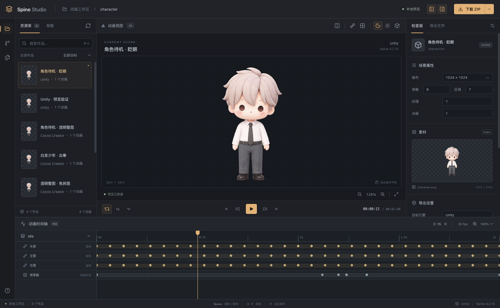
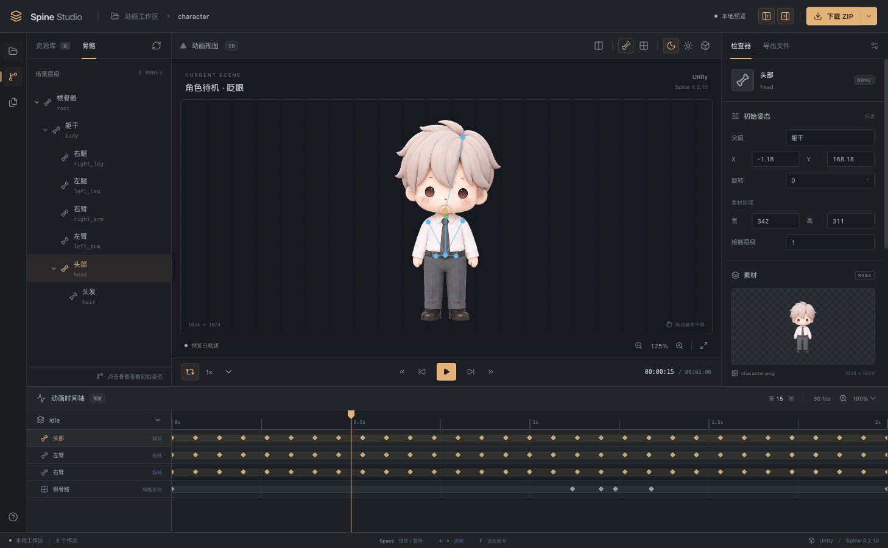
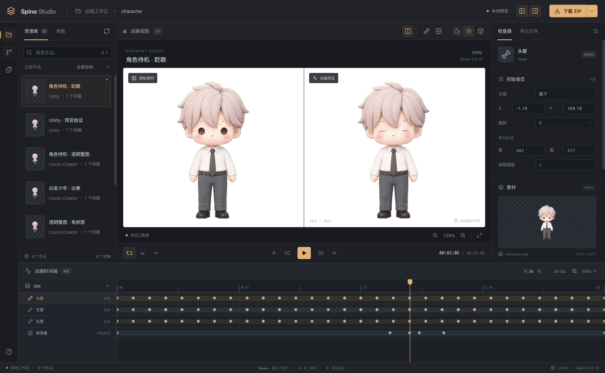

# animation-2d

让 agent 把角色图片生成 Spine 动画，支持待机、眨眼和骨骼形变，
导出 JSON / atlas / PNG，并提供本地网页预览。

## 安装

### 直接发送给 agent 安装

复制以下内容发送给你的 agent：

```text
请安装 https://github.com/youtiaoguagua/animation-2d 中的 spine-animation skill。
使用 skills CLI 安装到你自己的用户级技能目录，准备 Node.js 22.20+ 和 pnpm。
安装后按 SKILL.md 运行环境自检，修复基础生成与预览所需依赖，并报告安装结果。
```

### 手动安装

准备 Node.js 22.20+ 和 pnpm。以下以 Codex 为例：

```bash
npx skills add youtiaoguagua/animation-2d --skill spine-animation --agent codex -g
pnpm --dir ~/.agents/skills/spine-animation --ignore-workspace install --prod --frozen-lockfile
node ~/.agents/skills/spine-animation/scripts/spine.mjs doctor --segmentation mesh --preview
```

其他 agent 可替换 `--agent codex`，并使用对应技能目录执行依赖安装和自检。

也可下载 [v0.2.0 独立技能包](https://github.com/youtiaoguagua/animation-2d/releases/download/v0.2.0/spine-animation-skill-0.2.0.tgz)，
解压到对应技能目录后安装生产依赖。

## 使用

开始制作时先提供工作台地址；Codex 桌面端可用时直接在当前聊天右侧打开，生成后继续在同一工作台查看。

制作前选择导出目标，默认推荐 **Unity**；也可以在请求中直接指定目标。
工作图默认长边 **512 px**、PNG 不超过 **512 KiB**，保留原图并在缩图后规划骨骼；高清需求可明确调整预算。

附上角色图片并发送：

```text
$spine-animation 将这张角色图做成 2 秒循环待机动画，头部轻摆、双眼眨眼，
优先透明整图蒙皮，并打开预览。
```

素材与分层、动画效果、最终交付设有人工质检；agent 会先展示图片或预览，确认后继续。
制作时按动作选择整图蒙皮、关节拆层或替换姿态；大幅动作按需补齐遮挡区域，检查独立关节和实际动作，详见[绑定策略、补图与动作自检](skills/spine-animation/references/artwork-completion.md)。

基础功能无需 Python 或单独的模型 API Key，SAM 分割按需启用。
详细用法见[技能说明](skills/spine-animation/SKILL.md)和[抠图与透明素材说明](skills/spine-animation/references/cutouts.md)。
可编辑的 `.spine` 文件另需已授权的 Spine 编辑器。

## 界面预览

资源库、动画画布、检查器与逐帧时间轴。



骨骼层级选择与初始姿态检查。



原图对照、透明边缘与眨眼关键帧检查。



## 开发

源码开发使用 Node.js 22.20+ 和 pnpm。

```bash
git clone https://github.com/youtiaoguagua/animation-2d.git
cd animation-2d
pnpm install
pnpm run doctor
pnpm check
pnpm test
pnpm demo
```

`pnpm demo` 生成带眨眼的待机示例并返回预览链接，服务会持续运行。
重新打开已有作品：`pnpm preview --output ./output`。

工作台使用 React + Vite，支持资源筛选、骨骼检查、逐帧时间轴、原图对照、
画布缩放平移及 ZIP 资源包下载，也可通过下拉菜单下载单个文件。
右上角 **GIF** 可导出当前完整动画，默认长边 512 px、20 fps，可选透明、浅色或深色背景。
工作台每 2.5 秒检测资源变更，自动载入新作品并重载当前作品的动作、贴图和导出文件，保留播放位置、缩放和平移；切回页面时立即检查。
前端源码位于 `web/studio/`，构建输出到 `web/dist/`。
开发时将下面的地址替换为预览服务实际返回的地址：

```bash
SPINE_PREVIEW_URL=http://127.0.0.1:3100 pnpm web:dev
pnpm web:build
```

修改 `agent/`、`server/` 或 `web/` 中的源码后，更新并提交技能分发文件：

```bash
pnpm skill:prepare  # 更新供 skills 安装的分发文件
pnpm skill:install  # 安装到本机
pnpm skill:pack     # 生成 dist/ 下的独立安装包
```

技能构建会先编译前端，将 `web/dist/` 的内容直接复制到技能的 `web/`。
安装后的技能只需运行原生依赖和静态页面，无需 React、Vite 等开发依赖。

示例素材位于 `assets/demo/`，分层处理实验位于 `plans/character-punch/`；动作效果按上述质检流程验收。
个人项目的 `plans/<项目>/`、生成输出和临时文件默认仅保留本地；
公开示例 `plans/character-punch/`、测试源码 `temp/test/` 和技能分发文件继续随仓库维护。

使用 [Apache-2.0](LICENSE) 许可证，保留原有 [NOTICE](NOTICE)。
